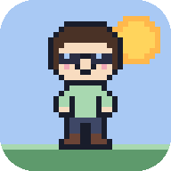
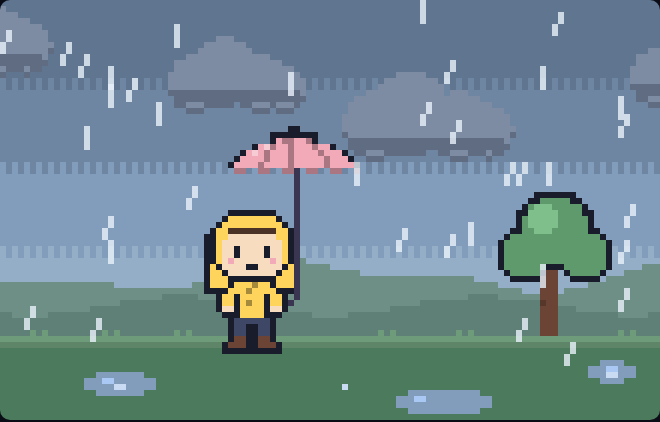
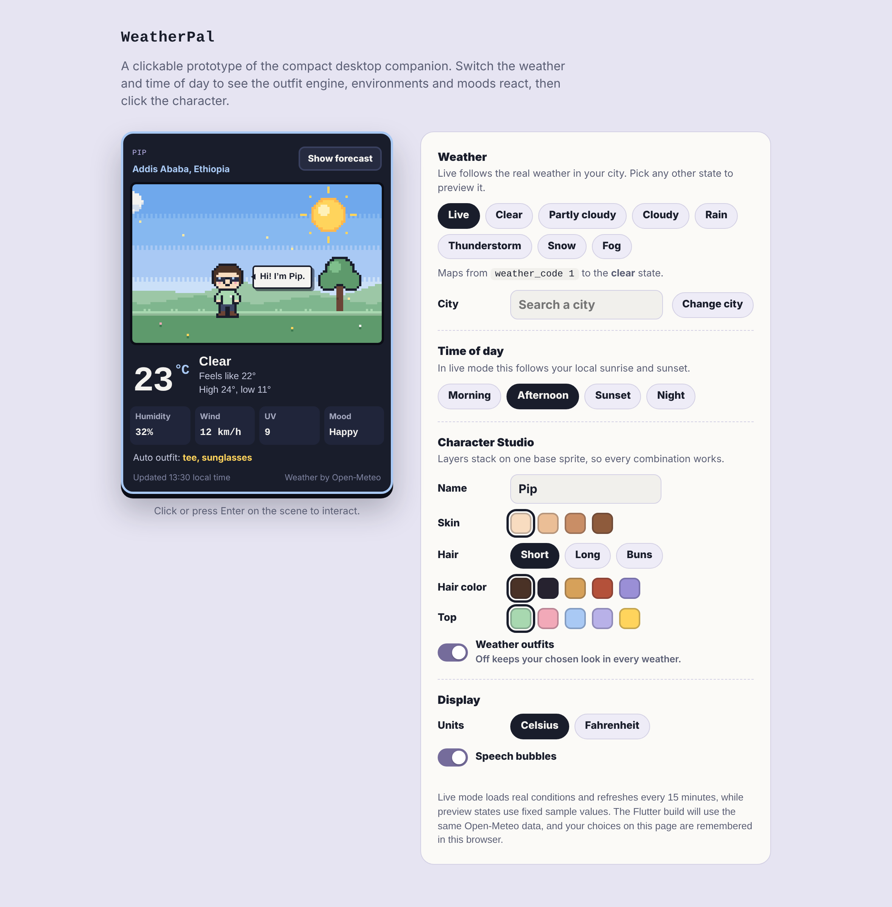
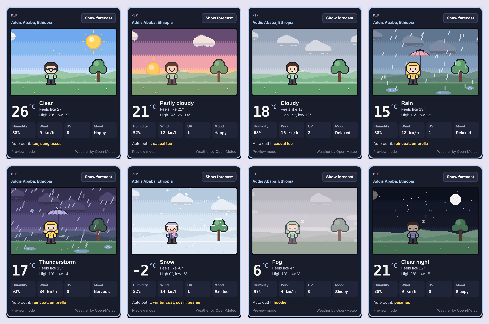
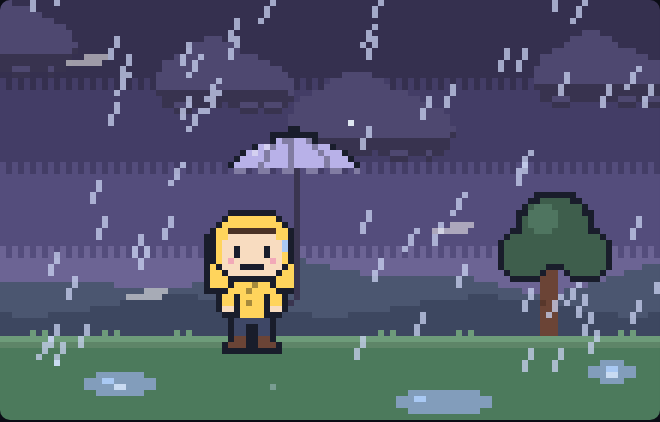
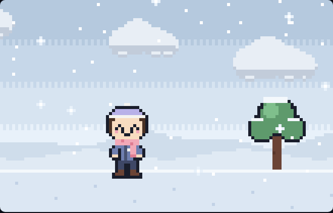
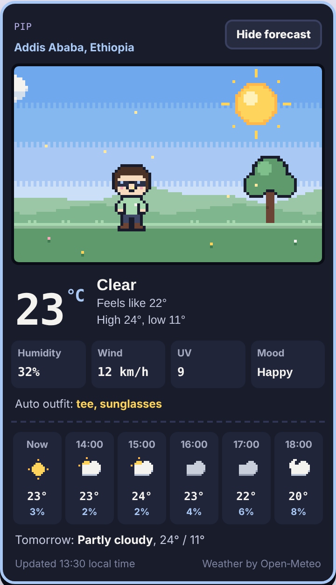
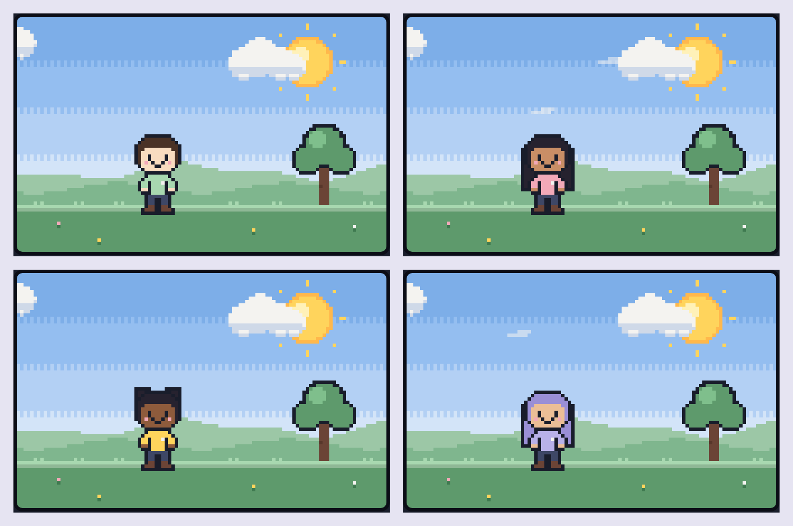
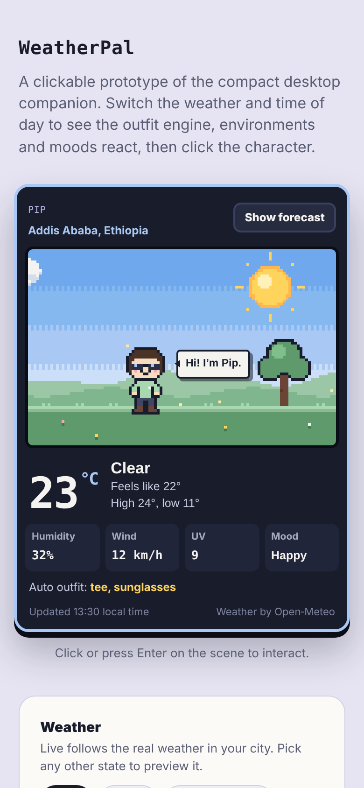
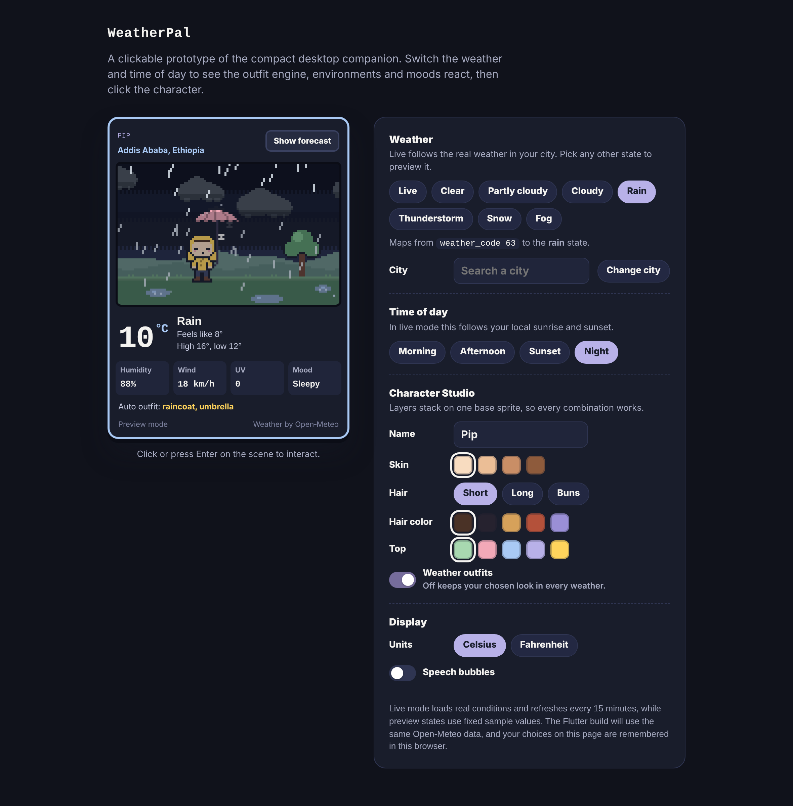

<p align="center">
  
</p>

<h1 align="center">WeatherPal</h1>

<p align="center">
  <b>Your personal weather companion.</b><br>
  A cozy pixel-art buddy that dresses for the real weather, lives in a tiny animated world, and tells you what it's like outside.
</p>

<p align="center">
  
  
  
  
  
</p>

<p align="center">
  
</p>

---

> [!NOTE]
> **This repository is the working prototype.** It is a single HTML file that proves the core idea end to end: real weather in, a character that reacts to it out. The full cross-platform app (Windows desktop companion and Android) will be built in Flutter, following the [full specification](docs/SPECIFICATION.md).

## Contents

- [What it is](#what-it-is)
- [Screenshots](#screenshots)
- [What works in the prototype](#what-works-in-the-prototype)
- [Run it](#run-it)
- [How it works](#how-it-works)
- [Design system](#design-system)
- [Project structure](#project-structure)
- [Roadmap](#roadmap)
- [Privacy and accessibility](#privacy-and-accessibility)
- [Contributing](#contributing)
- [License and credits](#license-and-credits)

## What it is

Most weather apps are a wall of numbers. WeatherPal turns checking the weather into a glance at a tiny virtual world: a small pixel-art character stands in a scene that matches the sky outside your window. When it rains, the character puts on a raincoat and opens an umbrella, and the drops bounce off it. When it snows, the ground slowly turns white and the character bundles up in a scarf and beanie. At night the stars come out and the character gets sleepy.

Think of it as a tiny virtual pet that happens to understand the weather.

## Screenshots

### The prototype on desktop

The companion widget sits on the left. The panel on the right switches weather states, changes the time of day, and customizes the character.

<p align="center">
  
</p>

### Every weather state

Each state has its own sky, clouds, ground, particles, outfit and mood. The outfit line in the widget shows what the outfit engine chose.

<p align="center">
  
</p>

| State | Scene | Outfit | Mood |
|---|---|---|---|
| Clear | Bright sky, sun with pulsing rays, floating light motes, flowers in the grass | Tee and sunglasses | Happy |
| Partly cloudy | Sun with a few drifting white clouds | Casual tee | Happy |
| Cloudy | Soft gray-blue sky, several clouds, light wind streaks | Casual tee | Relaxed |
| Rain | Dark clouds, slanted rain, rippling puddles, rain bouncing off the umbrella | Raincoat with hood, umbrella | Relaxed |
| Thunderstorm | Purple sky, heavy rain, lightning bolts with screen flashes | Raincoat with hood, umbrella | Nervous, surprised by thunder |
| Snow | Icy sky, drifting snowflakes, snow piling up on the ground and tree | Winter coat, scarf, beanie | Excited |
| Fog | Muted scene with moving fog bands | Hoodie | Sleepy |
| Night | Dark sky, twinkling stars, moon | Pajamas (on clear and cloudy nights) | Sleepy, with floating z's |

### Animated scenes

| Rain | Thunderstorm | Snow |
|---|---|---|
|  |  |  |

### Forecast view and Character Studio

<table>
  <tr>
    <td width="40%" valign="top">
      
      <p><b>Forecast.</b> The next six hours with pixel icons, temperature and chance of precipitation, plus tomorrow's high and low.</p>
    </td>
    <td width="60%" valign="top">
      
      <p><b>Character Studio.</b> Skin tone, hairstyle, hair color, top color and name. Every option is a layer on one base sprite, so every combination works without a separate drawing for each.</p>
    </td>
  </tr>
</table>

### Phone and dark theme

<table>
  <tr>
    <td width="32%" valign="top"><p align="center">Phone layout</p></td>
    <td width="68%" valign="top"><p align="center">Dark theme (follows your system setting)</p></td>
  </tr>
</table>

<sub>Screenshots were captured from the prototype with example data. On your machine the headings use the Press Start 2P and Nunito fonts.</sub>

## What works in the prototype

**Live weather**
- Real current conditions from the Open-Meteo API: temperature, feels-like, humidity, wind, UV index, today's high and low.
- Hourly forecast for the next six hours and tomorrow's outlook.
- Day, morning, sunset and night picked from the location's real sunrise and sunset times.
- Automatic refresh every 15 minutes, with retries that wait longer after each failure.
- The last successful result is saved, so the app still shows something offline and says how old it is.
- City search through the Open-Meteo Geocoding API. The default city is Addis Ababa, Ethiopia.

**Character**
- A 16 × 24 pixel character built from layers: back hair or hood, body, clothing, face, accessories and held items.
- An outfit engine that picks clothes from the weather state, never at random.
- A manual mode that keeps your chosen look in every weather.
- Moods and expressions: happy, relaxed, nervous, excited, sleepy and surprised.
- Idle life: blinking, breathing bob, puddle hops in the rain, waves in the morning, shivers in the snow, z's at night.
- Click or press Enter on the character to make it jump or wave.
- Rule-based speech bubbles such as "Don't forget your umbrella!" (can be turned off).

**World**
- Seven weather environments, four times of day, and smooth crossfades when either changes.
- Particle effects: rain that splashes on the ground and bounces off the umbrella, accumulating snow, lightning, fog bands, wind streaks and sun motes.
- Pixel-perfect rendering: the scene is drawn at 110 × 70 pixels and scaled 3× with nearest-neighbor filtering.

**Interface**
- Compact 360 px widget based on the desktop companion size in the spec.
- Celsius and Fahrenheit, km/h and mph.
- Light and dark page themes that follow the system setting.
- Settings remembered between visits.
- Preview mode to try every weather state and time of day by hand.

## Run it

The whole prototype is one file, [`index.html`](index.html). It has no build step and no dependencies to install.

**Quickest:** download `index.html` and open it in Chrome, Edge or Firefox.

**With VS Code:**
1. Clone the repository and open the folder in VS Code.
2. Install the **Live Server** extension.
3. Right-click `index.html` and choose **Open with Live Server**. The page reloads every time you save.

**Online with GitHub Pages:**
1. In this repository go to **Settings → Pages**.
2. Under **Build and deployment**, choose **Deploy from a branch**, select `main` and `/ (root)`, then save.
3. After a minute the prototype is live at `https://<your-username>.github.io/<repository-name>/`.

You need an internet connection for live weather and the web fonts. Without one, the prototype shows the last saved weather and falls back to system fonts.

## How it works

The prototype follows the same separation the Flutter app will use. Weather data is turned into a normalized **weather state**, and the character, outfit and environment each react to that state on their own. This keeps the logic out of one giant chain of conditions.

```
Open-Meteo API ──► weather state engine ──► { weather, time of day }
                                                   │
                       ┌───────────────────────────┼───────────────────────────┐
                       ▼                           ▼                           ▼
                 outfit engine              environment engine          personality rules
          (clothes, accessories, mood)   (sky, ground, particles,     (idle actions, speech
                                          lighting, transitions)          bubbles)
```

### Weather codes to states

Open-Meteo reports conditions as WMO weather codes. The state engine maps them like this:

| WMO code | Meaning | WeatherPal state |
|---|---|---|
| 0, 1 | Clear, mainly clear | `clear` |
| 2 | Partly cloudy | `partly` |
| 3 | Overcast | `cloudy` |
| 45, 48 | Fog, rime fog | `fog` |
| 51–67, 80–82 | Drizzle, rain, freezing rain, showers | `rain` |
| 71–77, 85, 86 | Snow, snow grains, snow showers | `snow` |
| 95–99 | Thunderstorm, with or without hail | `storm` |

### Time of day

| Rule | Time of day |
|---|---|
| More than 30 min before sunrise, or more than 40 min after sunset | Night |
| Up to 2.5 hours after sunrise | Morning |
| From 75 min before sunset until 40 min after | Sunset |
| Anything else | Afternoon |

### Data refresh

| Behavior | Detail |
|---|---|
| On open | Shows the saved result straight away, then fetches fresh data |
| While open | Refreshes every 15 minutes |
| On failure | Retries after 5 s, then 10 s, 20 s and so on, up to 5 minutes |
| Offline | Keeps showing the saved result and labels it with its time |
| API keys | None needed; Open-Meteo is keyless |

## Design system

### Colors

| Name | Hex | Used for |
|---|---|---|
| Midnight Navy | `#191D2B` | Widget background, outlines |
| Soft Lavender | `#B8B1E8` | Accents, pajamas, storm umbrella |
| Sky Blue | `#A9C9F4` | Widget frame, clear sky |
| Cloud White | `#F4F3F0` | Text, clouds |
| Sunshine Yellow | `#FFD45C` | Sun, raincoat, highlights |
| Mint Green | `#A8D8B0` | Grass, positive accents |
| Rain Blue | `#829DBB` | Rain sky, puddles |
| Storm Purple | `#756C9B` | Storm sky, toggles |
| Snow White | `#E8F1FA` | Snow scenes |
| Sunset Pink | `#F2A9B8` | Sunset sky, cheeks, umbrella |

### Typography

| Role | Typeface |
|---|---|
| Pixel headings and the character's name | Press Start 2P |
| Interface text | Nunito |
| Weather details | Nunito Sans |
| Numbers | JetBrains Mono |

Pixel fonts are used only for short headings, because they get hard to read at small sizes.

### Dimensions

| Element | Size |
|---|---|
| Compact widget | 360 px wide, 16 px corners, 3 px border |
| Scene | 110 × 70 pixels, shown at 3× (330 × 210 px) |
| Character | 16 × 24 pixels, about 30 % of the scene height |

## Project structure

```
.
├── index.html               The whole working prototype (HTML, CSS and JavaScript)
├── assets/
│   └── icons/               App icons (192, 512, maskable 512, Apple touch icon)
├── docs/
│   ├── SPECIFICATION.md     Full product and technical specification
│   └── screenshots/         Images and GIFs used in this README
├── CHANGELOG.md
├── LICENSE
└── README.md
```

Inside `index.html` the script is split into clear sections:

| Section | What it does |
|---|---|
| Live weather | Fetches, caches and maps Open-Meteo data |
| Character sprite | The 16 × 24 base sprite (`BODY`) as rows of letters, one per pixel |
| Outfit engine | `outfit()` turns the weather state into clothes, accessories and an expression |
| Environment | Sky, sun, moon, clouds, hills, tree and ground for each state |
| Particles | Rain, snow, fog, wind, sparkles, splashes and z's |
| Speech bubbles | `LINES` holds the rule-based phrases for each state |
| UI | Widget values, forecast strip and the control panel |

## Roadmap

The prototype covers the core experience. The production app will be built in **Flutter** for Windows and Android, following these milestones from the specification.

| | Milestone | Status |
|---|---|---|
| ✅ | Working HTML prototype with live weather, outfit engine, environments and customization | Done |
| ⬜ | 1. Flutter project setup and design system | Next |
| ⬜ | 2. Live weather API and location selection | |
| ⬜ | 3. Weather state detection engine | |
| ⬜ | 4. Character assets and sprite animations | |
| ⬜ | 5. Dynamic backgrounds and weather effects | |
| ⬜ | 6. Avatar customization and saved presets | |
| ⬜ | 7. Hourly and seven-day forecast screens | |
| ⬜ | 8. Windows desktop companion (always on top, system tray, start with Windows) | |
| ⬜ | 9. Local persistence and weather notifications | |
| ⬜ | 10. Android home-screen widget | |
| ⬜ | 11. Testing, optimization and documentation | |

Ideas for later: a cozy bedroom scene with rain on the window, a collectible wardrobe with seasonal outfits, a weather journal, multiple characters, and air quality.

See the [full specification](docs/SPECIFICATION.md) for details on every feature.

## Privacy and accessibility

- **No accounts, no API keys, no tracking.** The prototype talks only to Open-Meteo.
- **Location is never required.** The prototype uses a city you choose; it does not ask for GPS.
- **Saved data stays on your device** in the browser's local storage.
- The scene has a text description for screen readers that updates with the weather and outfit.
- The character can be activated with the keyboard (Tab, then Enter or Space).
- Motion is reduced when your system has "reduce motion" turned on.

## Contributing

This is a personal project, but ideas and bug reports are welcome. Open an issue describing what you saw or what you'd like, with a screenshot if it helps. For code changes, fork the repository, make your change on a new branch, and open a pull request with a short explanation.

## License and credits

- Code is released under the [MIT License](LICENSE).
- Weather data by [Open-Meteo.com](https://open-meteo.com/), licensed under [CC BY 4.0](https://creativecommons.org/licenses/by/4.0/). The free API is for non-commercial use.
- Fonts from Google Fonts: Press Start 2P, Nunito, Nunito Sans and JetBrains Mono, all under the SIL Open Font License.
- All pixel art in this repository is original and drawn in code.
